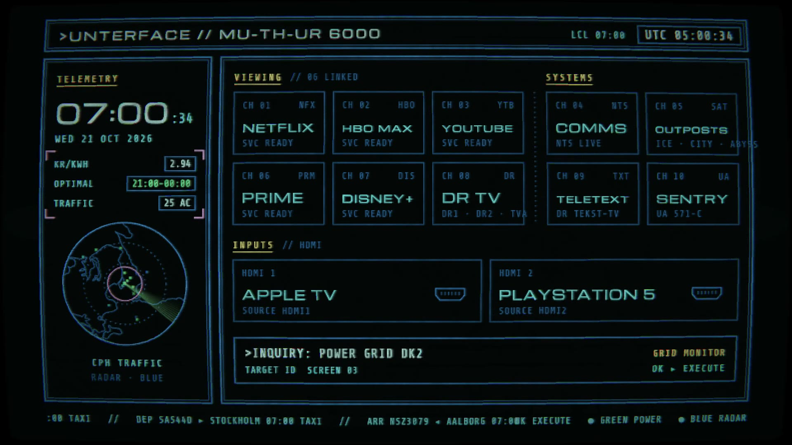
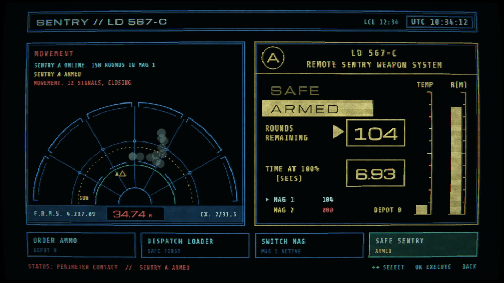

# Ostromo for LG

> [!NOTE]
> Not finished software. A home screen I made for my own LG TV, shared as is. Expect to tweak it, with some
> coding know-how or a coding agent like Claude Code, and use it at your own risk.

## TL;DR

1. **On the TV:** install LG's free **Developer Mode** app, sign in with a free LG developer account, switch on
   Dev Mode and Key Server, and note the IP address and passphrase.
2. **Download** `ostromo_x.y.z.ipk` from the [latest release](https://github.com/Staiola/Ostromo-for-LG/releases/latest).
3. **Install it:** paste the prompt from [the install guide](INSTALL.md) into Claude Code, or use the webOS Dev
   Manager app.
4. **Open Ostromo** and pick your apps and inputs in SETUP. Hold a number key on the remote to pin it.

A home screen for LG webOS TVs that looks like the ship computers in *Alien* and *Aliens*: blue vector lines on black, a worn picture tube, and a boot card that plots itself on. It launches the streaming apps and HDMI inputs, and around them it shows live flights over Kastrup, today's electricity prices, webcams at research stations, NTS radio, DR's teletext and a sentry gun.



More about it, with video: [staiola.studio/apps/ostromo](https://staiola.studio/apps/ostromo)

## Try it

Version 0.9.2 is a beta. Download `ostromo_0.9.2.ipk` from the
[latest release](https://github.com/Staiola/Ostromo-for-LG/releases/latest) and follow
**[the install guide](INSTALL.md)**. It uses LG's free Developer Mode, so nothing is rooted, and it can be
installed by hand or by asking Claude Code to do it.

Tested on an LG C5 (2025, webOS 25). It's free.

I built it for my own TV and have made it more generic, but it's a beta: expect rough edges, and expect to
tweak it for your own setup. That takes some coding know-how, or a coding agent such as Claude Code to do it
with you. Use it at your own risk.

What to expect:

- A SETUP screen on first start, for your apps, HDMI inputs, power prices, teletext and sounds.
- The flight radar is fixed to Copenhagen Airport, and power prices, DR TV and teletext are Danish.
- Sounds are a set made for the public version: typing, the motion tracker and the sentry gun.
- Home and quitting an app go to LG's home screen. Hold a number key to jump back, or run the optional Home
  watcher from the release on a computer that stays on.

## The code

Everything is in this repository, under the [MIT licence](LICENSE): change it, share it, build on it.

| Folder | What's in it |
|---|---|
| `nostromo/` | The webOS app: plain JavaScript drawing into a canvas, with a WebGL pass for the CRT look. One file per screen (`home.js`, `radar.js`, `power.js`, `sentry.js` …). |
| `nostromo-service/` | A small Node service installed next to the app on the TV. It fetches flights, prices, webcam stills and teletext, which the app can't reach directly. `dev-server.js` stands in for it on a computer. |
| `watcher/` | The optional Home watcher. |
| `scripts/` | `build-release.sh` builds the `.ipk`; `make-sounds-b.py` synthesises the sounds. |

**Run it on your computer** (needs [Node.js](https://nodejs.org)), then open http://localhost:8081. Arrow keys,
Enter and Esc stand in for the remote.

```bash
npm run nostromo:preview
```

**Put your own build on the TV.** Set up Developer Mode and register the TV as a device named `tv`, as in the
[install guide](INSTALL.md), with LG's `ares` tools installed (`npm install -g @webos-tools/cli`). Then:

```bash
npm run nostromo:install
```

**Start your TV with your own setup instead of SETUP:** copy `nostromo/preset.example.js` to
`nostromo/preset.js` and edit it.

Places to start tweaking:

- Apps a tile can launch, and their LG app ids: `nostromo/settings.js`.
- The radar's airport, map and town names: `nostromo/radar.js` and `nostromo-service/aircraft.js`.
- Power prices (Danish data from Energinet): `nostromo/power.js` and `nostromo-service/energy.js`.
- The webcams: `nostromo/outposts.js` and `nostromo-service/cams.js`.
- The CRT look: `nostromo/fx.js`.

Pointing Claude Code at this repository and describing what you want changed works well. Most of Ostromo
was made that way.

## Follow along

- On GitHub: **Watch → Custom → Releases** on this repository and you get a notice when there is something to install.
- Found a problem? [Open an issue](https://github.com/Staiola/Ostromo-for-LG/issues) and say which TV model you have.
- Like it? You can [support Ostromo on Ko-fi](https://ko-fi.com/F2F0LWM3Y).

## Notes

**23 October 2026, evening.** UnterFace is now called Ostromo, after its own boot card, and this
repository is Ostromo for LG. Version 0.9.2 changes only the name; installing it over an earlier version
keeps your setup.

**23 October 2026, later.** The code is now in this repository, under the MIT licence. Version 0.9.1 adds
sound. The typing blip, the tracker's ping and the gun are synthesised in code; the sonar beep for contacts
closing in is made on a synth in Logic. The tracker now pings on a steady beat while the contact beep speeds
up and rises as they get closer, and the first contact of an attack shows at once.

**23 October 2026.** Version 0.9, the first one for other TVs. New since the first notes: a SETUP screen,
Ostromo's own standby screen instead of LG's clock, a smoother frame rate on the C5, symbols the fonts
lacked now drawn by the app, and the film's names swapped for its own (the computer is MA-TH-OR 6200, the
gun an LD 567-C).

**21 October 2026.** First public notes. The home screen, power prices, flight radar, NTS radio, teletext, DR TV, eight webcams and the sentry screen all work on the TV. Two things LG will not let a developer-mode app do: see which app is in front, so quitting Netflix lands on LG's home screen rather than this one, and read the list of installed apps.



## Credits

- Fonts: Michroma and Share Tech Mono (SIL Open Font License), Bedstead (CC0). Licences in `nostromo/fonts/`.
- Video playback in the browser preview: [hls.js](https://github.com/video-dev/hls.js) (Apache 2.0), in `nostromo/lib/`.
- Map outlines: [Natural Earth](https://www.naturalearthdata.com) (public domain).
- Data: flights from [adsb.fi](https://adsb.fi) (personal, non-commercial use) and [adsbdb](https://www.adsbdb.com);
  electricity prices from Energinet's [Energi Data Service](https://www.energidataservice.dk); radio from
  [NTS](https://www.nts.live); teletext and live TV from [DR](https://www.dr.dk); webcams from the US Antarctic
  Program, the Australian Antarctic Division, the Norwegian Polar Institute, Øresundsbron, the Gemini Observatory
  and the Ocean Observatories Initiative. Their terms apply to their data.

---

Ostromo is a fan's homage to the screens in *Alien* (1979), *Aliens* (1986) and *WarGames* (1983), and has nothing to do with the people who made them.
